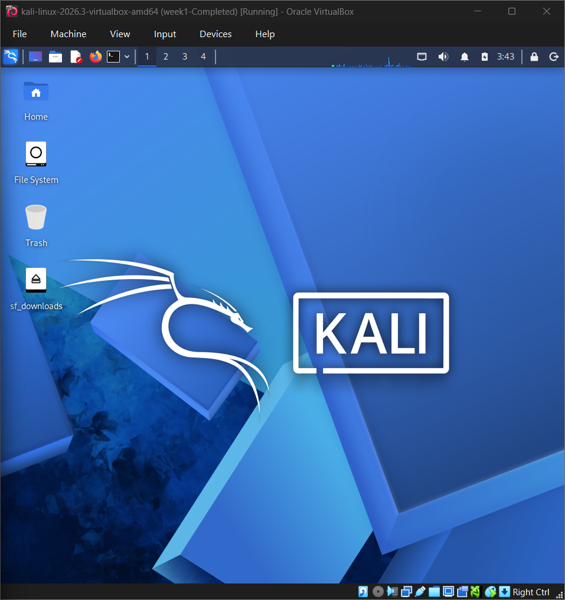
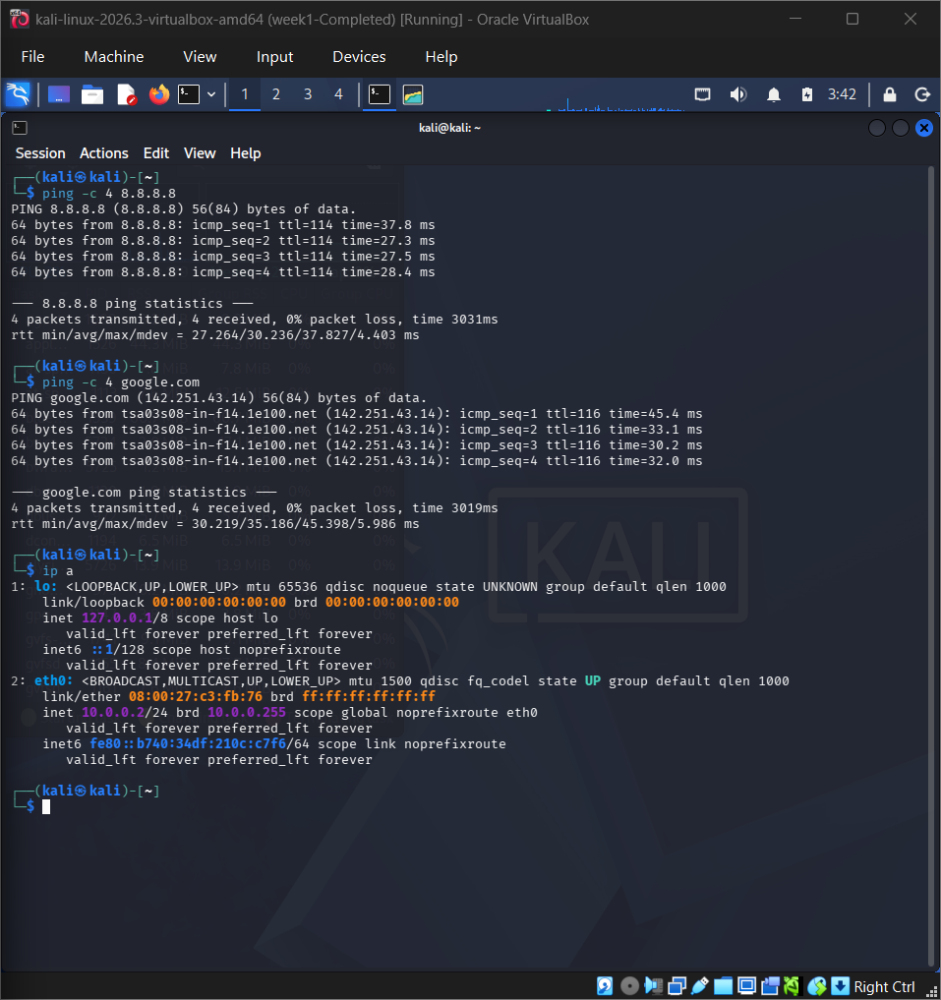
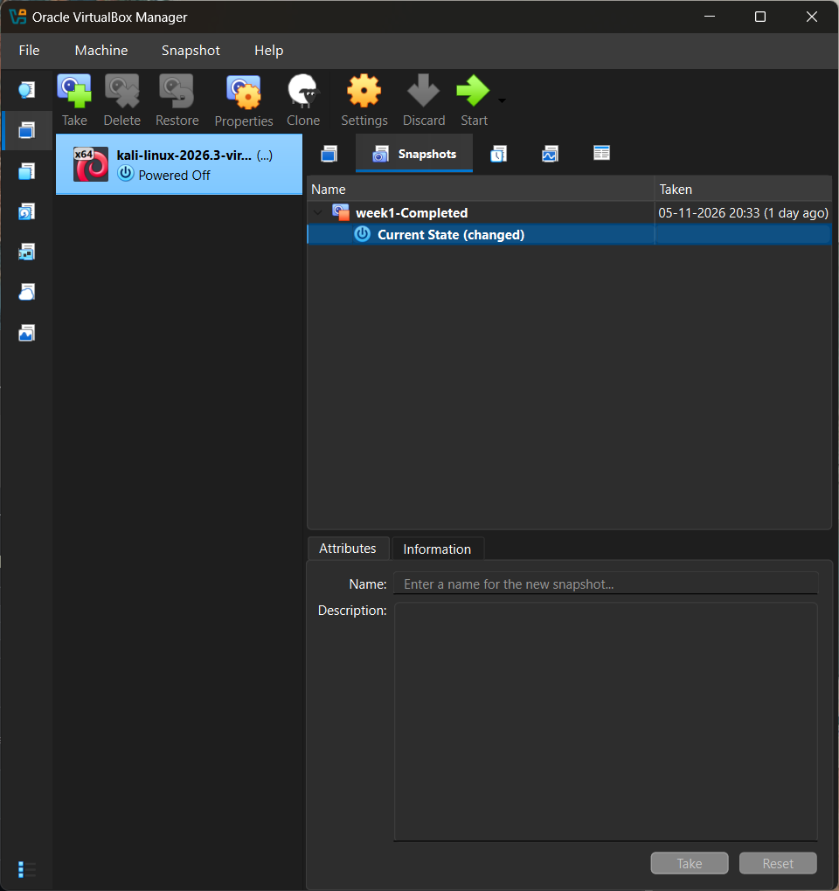

# WK1-PM1-CYBERSECURITY-LAB-SETUP

## Project Overview
This project involves setting up a cybersecurity
lab environment using VirtualBox and Kali Linux
for hands-on cybersecurity practice.

## Objective
To create a virtual environment for learning
Linux, networking, and cybersecurity fundamentals.

## Tools and Technologies
- Oracle VirtualBox
- Kali Linux
- Windows 11

## Implementation Steps
1. Installed Oracle VirtualBox.
2. Imported and configured Kali Linux.
3. Configured network settings.
4. Verified IP address configuration.
5. Tested network connectivity.
6. Created a virtual machine snapshot.

## Network Configuration
- IP Address: 10.0.0.2
- Gateway: 10.0.0.1
- DNS: 8.8.8.8

## Screenshots

### 1. Kali Linux Desktop

### 2. IP Configuration

### 3. VirtualBox Snapshot

## Learning Outcomes
- Understanding virtualization.
- Working with Kali Linux.
- Learning IP addressing and networking.
- Configuring NAT networking.
- Understanding VM snapshots.

## Conclusion
Successfully created a cybersecurity lab
environment using Kali Linux and VirtualBox
for future hands-on security practice.
